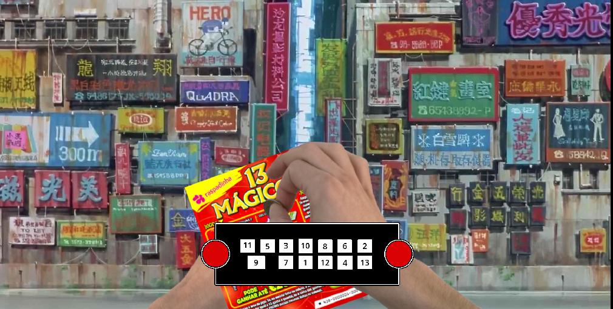
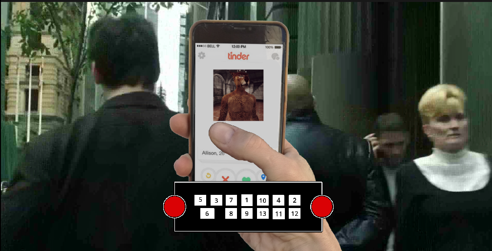

Play on itch.io

## About the project

*Count Toothertin* is an arcade game made for **Invictvs Game Jam 2023**, hosted by Fabamaq. The game was designed for casino machines.

## My role

I worked on the design of the game and on the internal game logic, as well as the level data and its handling.

## Details

| | |
|---|---|
| **Category** | Game Jam |
| **Year** | 2023 (Nov.) |
| **Engine** | Godot |
| **Language** | GDScript |
