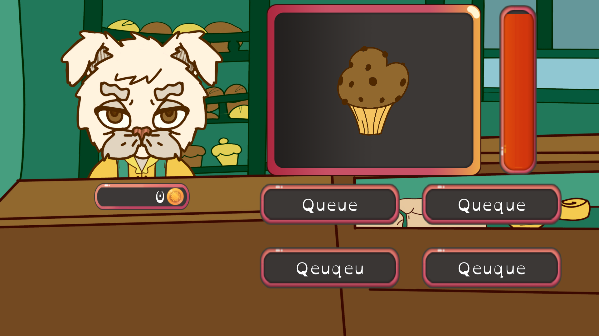
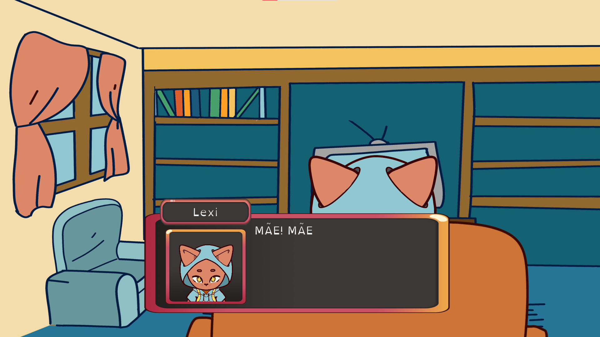

News article (IPCA)

## About the project

*Lexi's Adventure* is a 2D adventure serious-game concept designed to help dyslexic children.

The game features a visual novel style dialogue system, a minigame template with reading exercises, and a currency system to help Lexi progress through the game.

## Details

| | |
|---|---|
| **Category** | Academic game concept |
| **Year** | 2022 |
| **Engine** | Unity |
| **Language** | C# |
