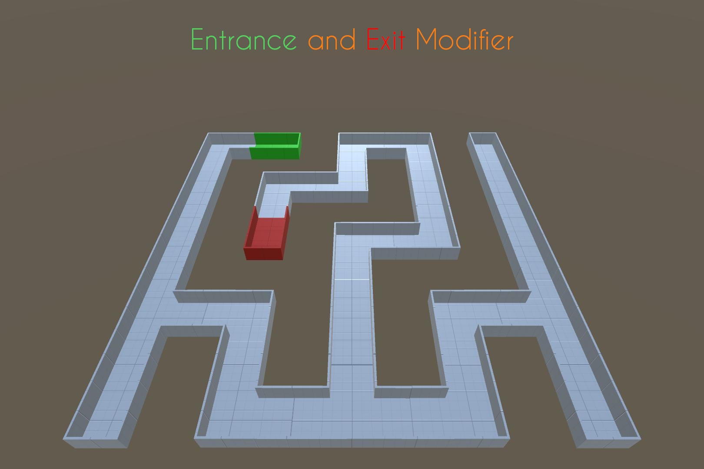
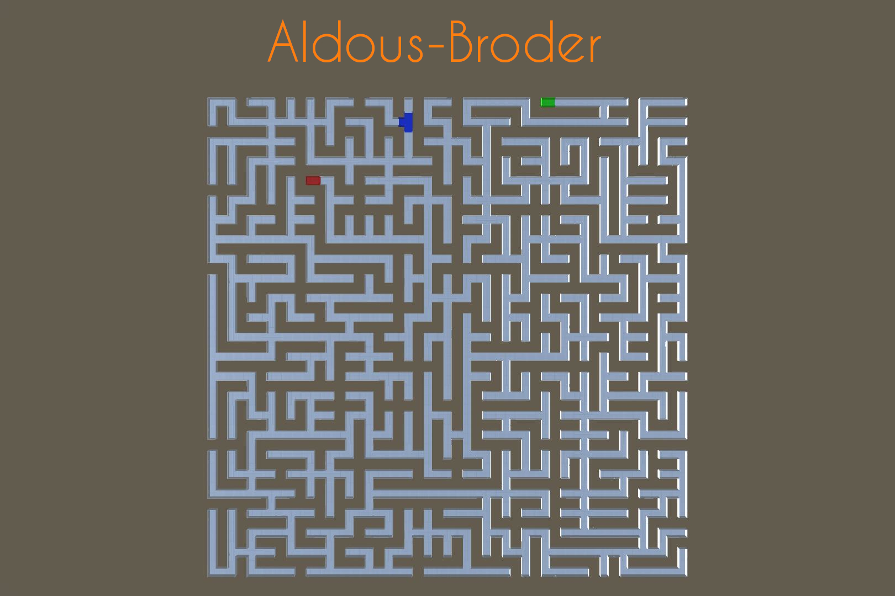

Unity Asset Store

## About the project

Inspired by *Mazes for Programmers* by Jamis Buck, my maze solution began as an academic exercise: implement the book's algorithms in the Unity engine.

Soon enough I started adding my own features, such as modifiers and drawing the maze as a texture for maps. So I decided to turn it into a commercial tool for the Asset Store.

## Details

| | |
|---|---|
| **Category** | Tools |
| **Year** | 2023 |
| **Engine** | Unity |
| **Language** | C# |
| **Topics** | Procedural generation |
