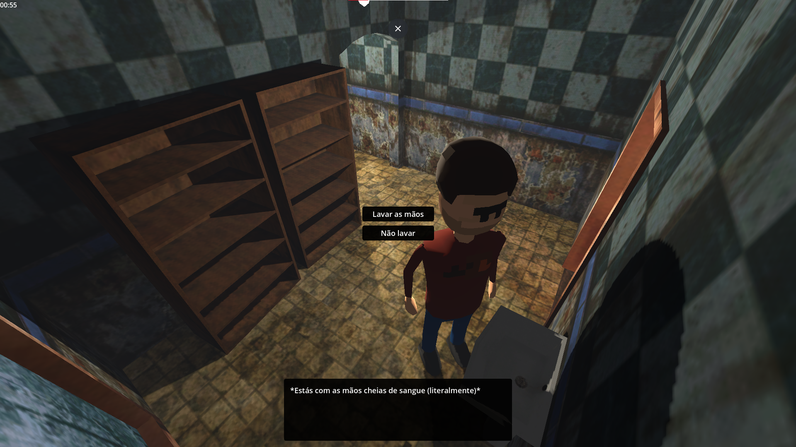
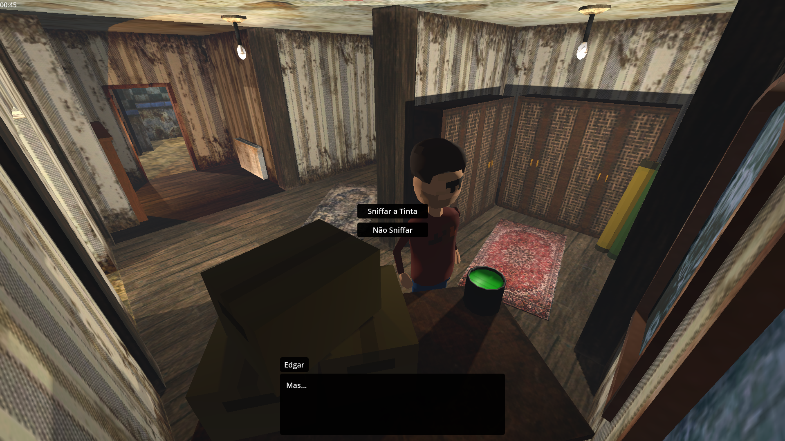

Play on itch.io

## About the project

*Moisés Morreu e eu Matei-o* is a small adventure game made for the **IPCA Game Jam 2024**. Inspired by not-so-real events, you play as a character who accidentally kills Moisés, and now has to hide the body without being discovered.

The game is only available in Portuguese.

## My role

I made the main character controller as part of a separate add-on I'm developing for survival horror games, and I designed the game structure and main logic.

## Details

| | |
|---|---|
| **Category** | Game Jam |
| **Year** | 2024 |
| **Engine** | Godot |
| **Language** | GDScript |
