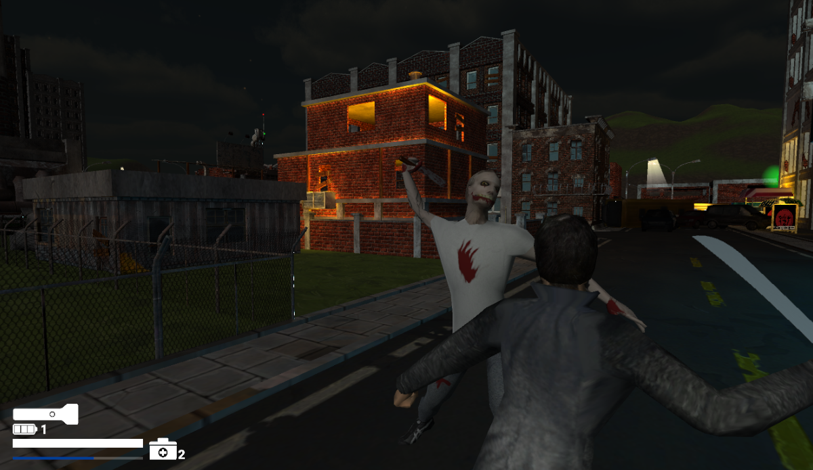
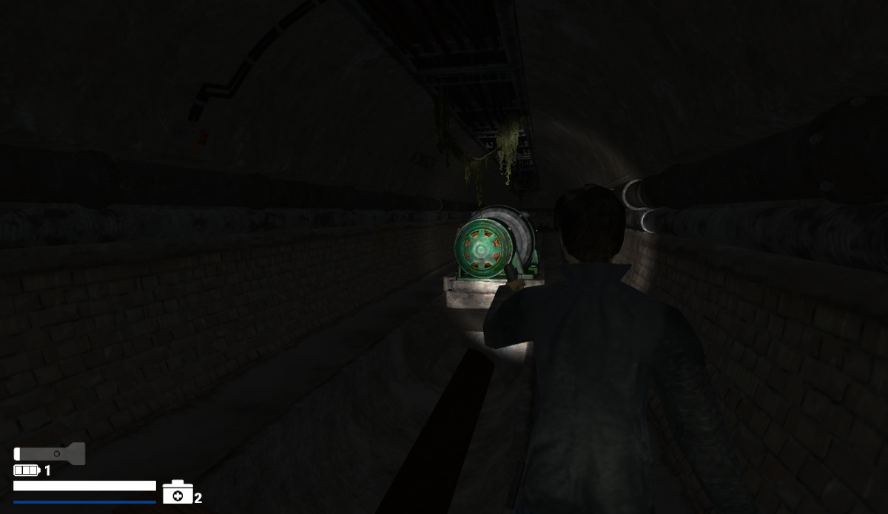

Steam page
itch.io

## About the project

The project started as a college work I developed solo, but now I intend to polish it and release it as a commercial game.

After a rescue operation gone bad, Sam is left for dead in the middle of the street. Rescued by a man only known as The Doctor and stuck in a shape-shifting city, Sam now spends this endless night trying to escape a hellish nightmare.

## What I worked with

Everything: programming, level design and writing, solo.

## Details

| | |
|---|---|
| **Category** | Academic game project |
| **Year** | 2023 |
| **Engine** | Unity |
| **Language** | C# |
